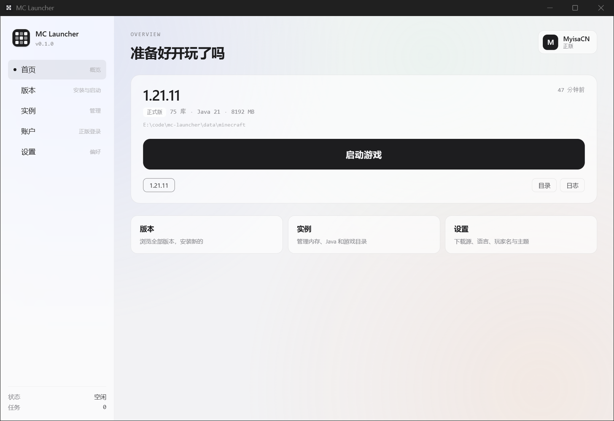
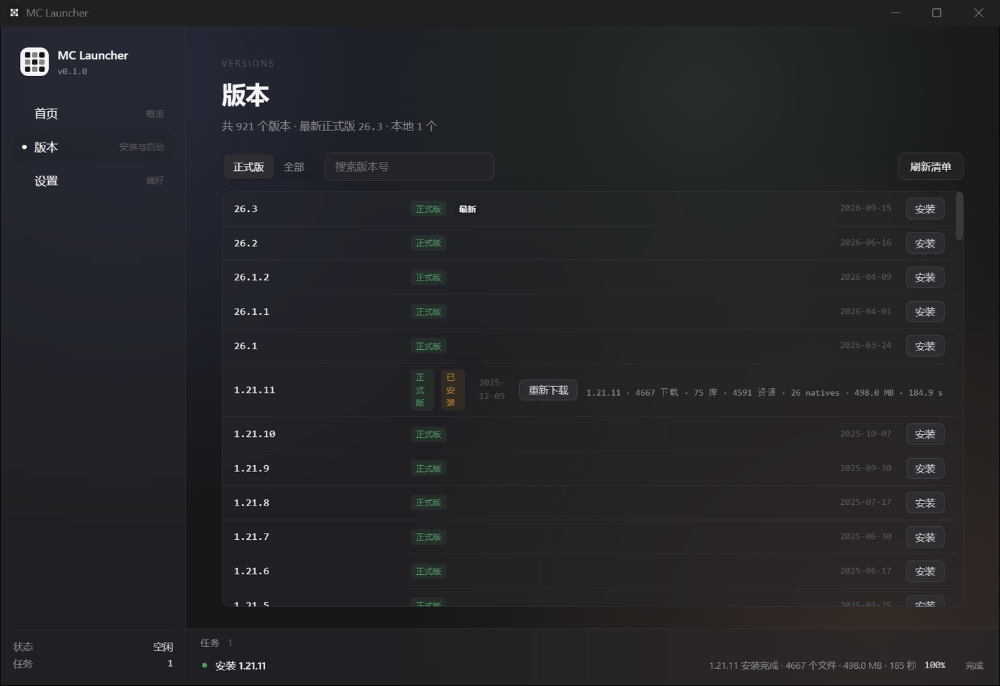
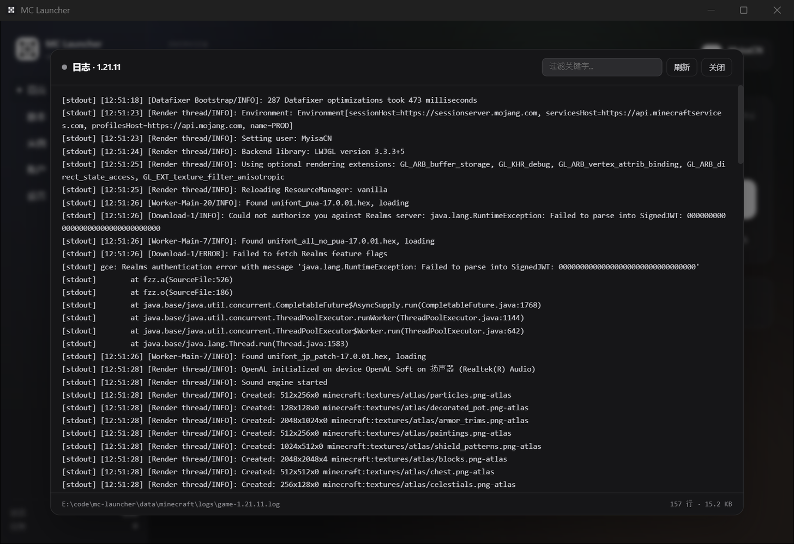
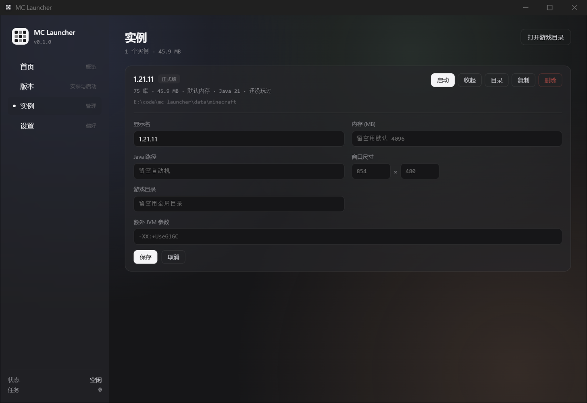
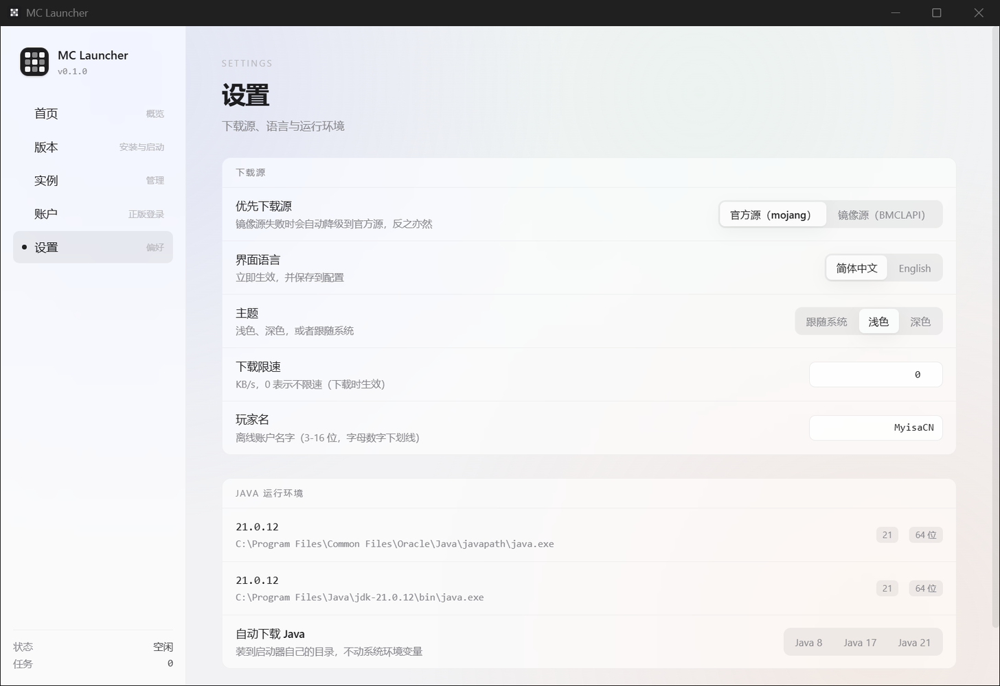

# MC Launcher

**English** | [简体中文](README.zh-CN.md)

An open-source Minecraft launcher written from scratch — Rust backend, Vue 3 frontend, Tauri 2 shell.
Cross-platform, ~10 MB.

Install vanilla Minecraft, launch the game, manage instances, and sign in with a Microsoft account.

> Status: **usable** — vanilla install, launch, instance management and Microsoft login all work.
> Good enough for daily use.



## Features

### Installing

- Version manifest with 921 versions (releases, snapshots, old alpha/beta), cached for 1 hour
- Full install: client jar + all libraries + assets + natives extraction
- **Mirror first** (BMCLAPI), falling back to the official source automatically
- 16 concurrent downloads, full SHA1 verification, atomic `.part` files, 3 retries
- `rules` engine filtering libraries and arguments by OS / arch / features (75 libs on Windows, 107 total)
- natives extraction with `extract.exclude` filtering and zip-slip protection

Measured on 1.21.11: **4,667 files / 498 MB / 185 s** (mirror at ~2.7 MB/s), every checksum passed.

### Launching

- classpath assembled from `rules`, platform separator handled (Windows `;` / Unix `:`)
- 20+ Mojang variable substitutions (`${classpath}`, `${auth_player_name}`, `${assets_root}`, `${auth_xuid}`, …)
- Legacy `minecraftArguments` field supported
- **Offline UUID matches Java's `UUID.nameUUIDFromBytes` exactly** — worlds and whitelists survive a launcher switch
- Pre-launch integrity check: missing files get reported instead of a broken game
- Java selection: instance override → lowest satisfying version → highest available
- stdout / stderr captured to disk and viewable in the UI

### Instances

Each instance carries its own memory / Java path / window size / game directory / extra JVM arguments.
Configs are written atomically (temp file + rename), can be duplicated, deleted, or verified.
A missing config never breaks launching — everything falls back to global defaults.

### Microsoft sign-in

- Device-code flow — **the password never touches the launcher**
- Uses Microsoft's public Xbox client ID, so **anyone who downloads the launcher can sign in**
  without registering their own Azure app
- Full chain: device code → MS token → Xbox Live → XSTS → Minecraft services → profile
  (uuid / skin / cape)
- Tokens live only in the local `accounts.json`; the UI layer never receives them
- Automatic refresh, multi-account switching, offline fallback when no account is present

### Java

- Scans system Java (registry / `JAVA_HOME` / common install paths / PATH), reads version and vendor
- **One-click JRE download**: Adoptium API for the version, Tsinghua TUNA mirror for the bytes
  (GitHub CDN stalls in China), unpacked into the launcher's own directory — system `PATH` untouched

Measured: Java 21 download → extract → `java -version` reports `21.0.13 LTS`.

### UI

- Launchpad home: current instance card + large launch button + account status + recent
- Log viewer reads from the tail of the file (up to 2 MB), with keyword filter
- Expandable task bar (progress / elapsed / current file / cancel)
- Theme: system / light / dark
- Download speed limit (KB/s)
- Chinese and English, switching takes effect immediately

### Roadmap

- [x] Download engine + full vanilla install
- [x] Actually launching the game
- [x] Instance management
- [x] Microsoft account sign-in
- [ ] Mod loaders (Fabric / Quilt / Forge / NeoForge / OptiFine)
- [ ] Mod management and modpacks (Modrinth / CurseForge)
- [ ] Launcher self-update
- [ ] Crash analysis

## Screenshots

| Install | Logs |
|---|---|
|  |  |

| Instance settings | Settings |
|---|---|
|  |  |

## Tech stack

| Layer | Technology |
|---|---|
| Backend core | **Rust** (download engine / version parsing / process management / auth) |
| Frontend UI | **Vue 3 + TypeScript** |
| Desktop shell | **Tauri 2** (WebView2 / WebKit, ~10 MB bundle) |
| Build | pnpm + Vite + Cargo |

## Architecture

Strict layering. The `core` layer depends on no framework, which keeps it unit-testable and portable.

```
src-tauri/src/
├── core/           pure logic, no IO side effects
│   └── models.rs       typed version JSON models, config structs
├── infra/          infrastructure
│   ├── http.rs         multi-source (official / BMCLAPI) selection + cache
│   ├── downloader.rs   streaming download + SHA1 + atomic write + rate limit
│   ├── task.rs         task scheduling (progress / cancel / events)
│   ├── logger.rs       leveled logging, daily rotation
│   └── paths.rs        application data directory
├── services/       business logic
│   ├── version.rs      version manifest, local version scan
│   ├── java.rs         Java probing (version / vendor / bitness)
│   ├── java_download.rs automatic JRE download
│   ├── instance.rs     instance config read / write / duplicate / verify
│   ├── install/        install pipeline
│   │   ├── rules.rs        rules evaluation (pure functions, unit tested)
│   │   ├── version_json.rs version JSON parsing + inheritsFrom merge
│   │   ├── plan.rs         build the download plan
│   │   ├── runner.rs       concurrent execution + progress aggregation
│   │   └── natives.rs      natives extraction
│   ├── launch/         launch pipeline
│   │   ├── classpath.rs    classpath assembly
│   │   ├── args.rs         argument template expansion
│   │   ├── account.rs      account + offline UUID
│   │   └── process.rs      child process management
│   └── auth/           authentication
│       ├── microsoft.rs    device-code chain
│       └── store.rs        account persistence (atomic write)
├── commands/       Tauri IPC (the only entry point for the frontend)
└── state.rs        global state
```

The frontend is layered the same way:

```
src/
├── services/ipc.ts    the only file that knows Rust command names
├── services/events.ts Tauri event subscriptions
├── services/theme.ts  theme application
├── types/index.ts     types shared with Rust (keep in sync with models.rs)
├── views/             pages
├── components/        reusable components
└── i18n/              zh-CN / en strings (zero dependencies)
```

## Development

```bash
pnpm install

# dev (Vite HMR + Tauri window)
pnpm tauri:dev

# build
pnpm tauri:build
```

### Requirements

- **Rust** ≥ 1.77
- **Node** ≥ 20 + pnpm
- **MSVC** (Visual Studio Build Tools 2022) or `webkit2gtk` on Linux
- **WebView2** (bundled with Windows 10/11)

### Data directory

Defaults to the system app-data directory; override it with an environment variable:

```bash
MC_LAUNCHER_DATA_DIR=D:\\path\\to\\data
```

## Design notes

**Mirror first.** Mojang's official source tops out around 400 KB/s from China; BMCLAPI reaches 2.7 MB/s.
The mirror leads and the official source is the fallback.

**Atomic writes.** Every config and token write goes through temp file + rename, so a power cut never
leaves half a JSON behind.

**Tokens never reach the UI.** The frontend `AccountInfo` struct simply has no token fields — doing it
wrong is impossible by construction.

**Offline UUIDs must match Java.** `MD5("OfflinePlayer:" + name)` plus RFC 4122 v3 bit twiddling.
Anything else and worlds stop recognizing the player after a launcher switch.

**Variable substitution order.** `${classpath_separator}` must be replaced before `${classpath}`,
otherwise the prefix eats it.

**`inheritsFrom` merges recursively.** That is the prerequisite for Forge / Fabric style
"parent version + patch" layouts.

**`<select>` does not fire `change` in WebView2.** The UI uses segmented buttons everywhere instead.

## License

MIT
