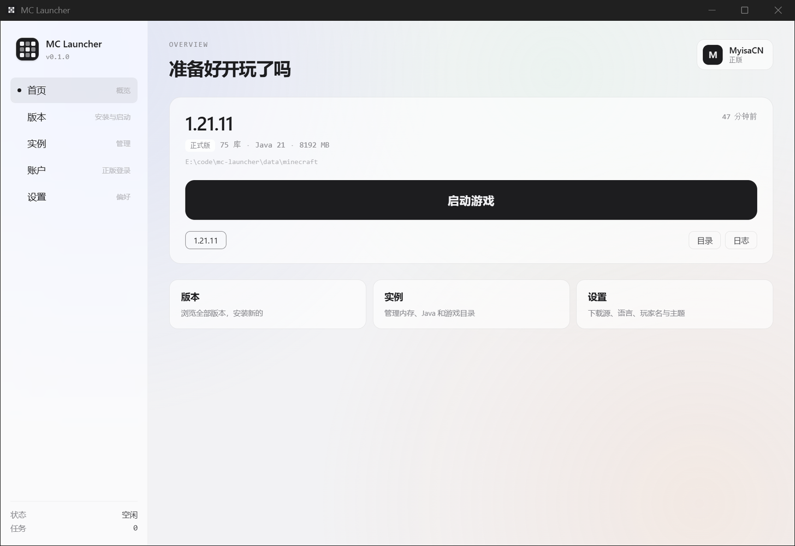
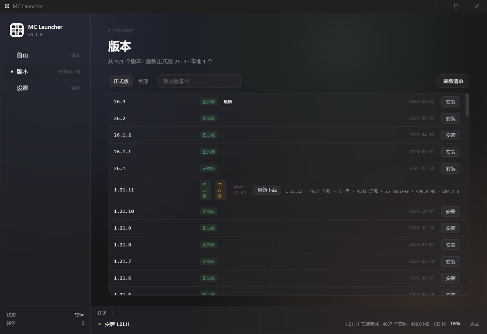
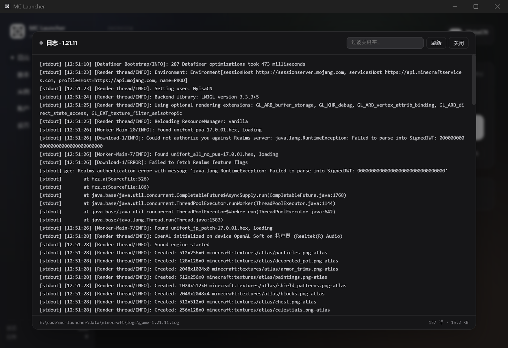
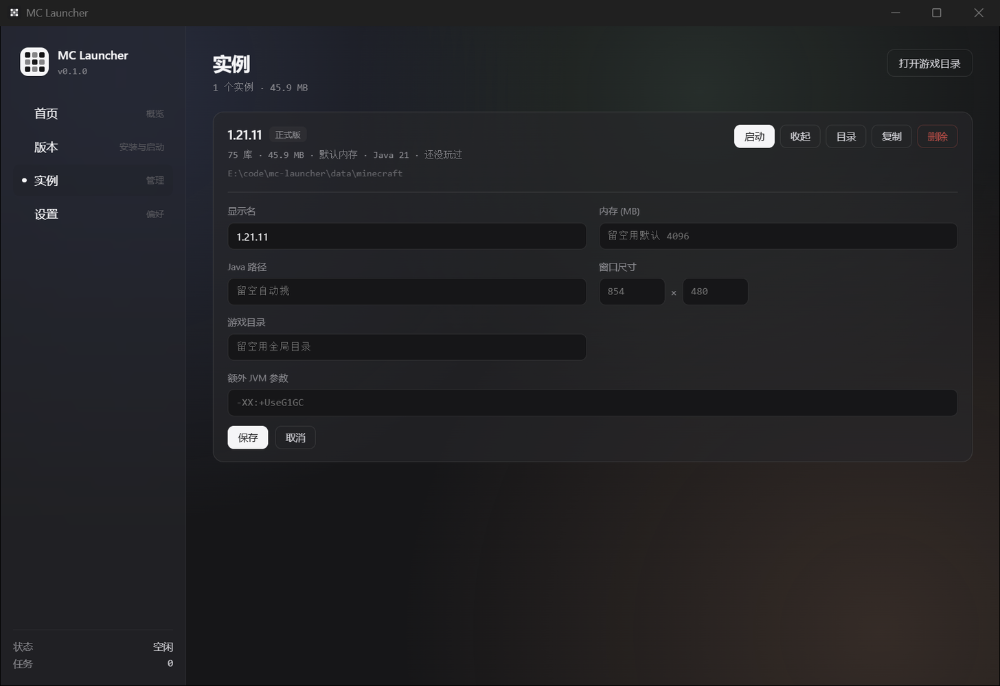
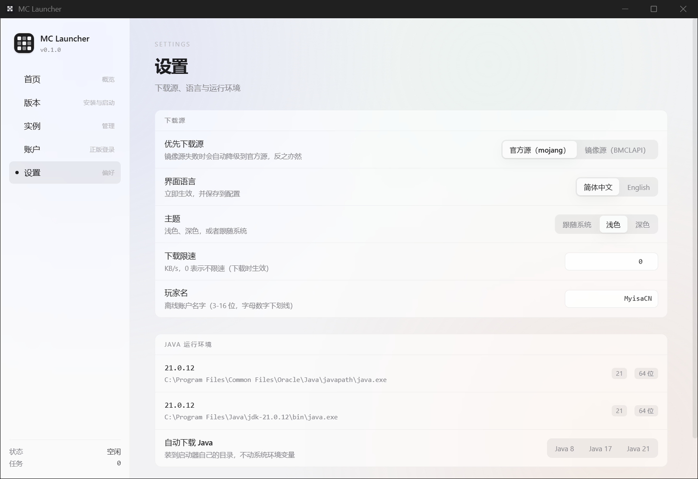

# MC Launcher

[English](README.md) | **简体中文**

一个从零写起的开源 Minecraft 启动器：**Rust 后端 + Vue 3 前端 + Tauri 2 外壳**，跨平台，约 10 MB。

装原版、开游戏、管实例、登微软账号，都在一个窗口里。

> 状态：**可用** —— 原版安装、启动、实例管理、微软正版登录全部跑通，日常能当启动器用。



## 功能

### 安装

- 版本清单 921 个版本（正式版 / 快照 / 远古版），本地缓存 1 小时
- 完整安装：客户端 jar + 全部依赖库 + 资源文件 + natives 解压
- **镜像优先**（BMCLAPI），失败自动降级官方源
- 并发 16 下载，SHA1 全量校验，`.part` 原子落盘，失败重试 3 次
- `rules` 引擎：按操作系统 / 架构 / 特性过滤库与参数（Windows 75 库，全量 107 库）
- natives 解压带 `extract.exclude` 过滤与 zip slip 防护

实测安装 1.21.11：**4667 个文件 / 498 MB / 185 秒**（镜像源约 2.7 MB/s），全部校验通过。

### 启动

- classpath 按 `rules` 拼装，平台分隔符自动切换（Windows `;` / Unix `:`）
- 20+ 个 Mojang 变量替换（`${classpath}`、`${auth_player_name}`、`${assets_root}`、`${auth_xuid}` …）
- 老版本的 `minecraftArguments` 字段兼容
- **离线 UUID 与 Java 的 `UUID.nameUUIDFromBytes` 完全一致** —— 换启动器存档、白名单都不认人
- 启动前完整性自检：缺文件直接报出来，而不是让游戏莫名其妙崩
- Java 挑选：实例指定 → 满足要求里最低的版本 → 兜底最高
- stdout / stderr 双管道捕获落盘，界面里直接看

### 实例

每个实例独立：内存 / Java 路径 / 窗口尺寸 / 游戏目录 / 额外 JVM 参数。
配置走「临时文件 + 改名」原子写，可复制、可删除、可校验。
配置丢了也不影响启动，一律回落到全局默认。

### 微软正版登录

- 设备码流程 —— **密码永远不经过启动器**
- 用微软公开的 Xbox 客户端 ID，**任何人下载了就能登录**，不用自己注册 Azure 应用
- 完整链路：设备码 → MS token → Xbox Live → XSTS → Minecraft 服务 → profile（uuid / 皮肤 / 披风）
- 令牌只落本地 `accounts.json`，前端永远拿不到
- 自动续期、多账户切换、没有正版时回落离线

### Java

- 自动扫描系统 Java（注册表 / `JAVA_HOME` / 常见安装路径 / PATH），读出版本与厂商
- **一键下载 JRE**：Adoptium API 查版本、清华 TUNA 镜像下载（直连 GitHub CDN 在国内会卡死），
  解压到启动器自己的目录，不动系统环境变量

实测：下载 Java 21 → 解压 → `java -version` 输出 `21.0.13 LTS`。

### 界面

- 启动台首页：当前实例大卡 + 巨型启动按钮 + 账户状态 + 最近玩过
- 日志查看器：从文件尾部读（最多 2 MB），带关键字过滤
- 任务栏可展开（进度 / 耗时 / 当前文件 / 取消）
- 主题：跟随系统 / 浅色 / 深色
- 下载限速（KB/s）
- 中英双语，切换即时生效

### 路线图

- [x] 下载引擎 + 完整安装原版
- [x] 真正启动游戏
- [x] 实例管理
- [x] 微软正版登录
- [ ] 模组加载器（Fabric / Quilt / Forge / NeoForge / OptiFine）
- [ ] Mod 管理与整合包（Modrinth / CurseForge）
- [ ] 启动器自动更新
- [ ] 崩溃分析

## 截图

| 安装 | 日志 |
|---|---|
|  |  |

| 实例设置 | 设置 |
|---|---|
|  |  |

## 技术栈

| 层 | 技术 |
|---|---|
| 后端核心 | **Rust**（下载引擎 / 版本解析 / 进程管理 / 认证） |
| 前端 UI | **Vue 3 + TypeScript** |
| 桌面壳 | **Tauri 2**（WebView2 / WebKit，产物约 10 MB） |
| 构建 | pnpm + Vite + Cargo |

## 架构

严格分层，`core` 层不依赖任何框架，方便单元测试与跨平台复用。

```
src-tauri/src/
├── core/           纯逻辑，无 IO 副作用
│   └── models.rs       版本 JSON 强类型模型、配置结构
├── infra/          基础设施
│   ├── http.rs         多源（官方 / BMCLAPI）选择 + 缓存
│   ├── downloader.rs   流式下载 + SHA1 校验 + 原子落盘 + 限速
│   ├── task.rs         任务调度（进度 / 取消 / 事件推送）
│   ├── logger.rs       分级日志，按天滚动
│   └── paths.rs        应用数据目录
├── services/       业务
│   ├── version.rs      版本清单、本地版本扫描
│   ├── java.rs         Java 探测（版本 / 厂商 / 位宽）
│   ├── java_download.rs JRE 自动下载
│   ├── instance.rs     实例配置的读写 / 复制 / 校验
│   ├── install/        安装流程
│   │   ├── rules.rs        rules 判定（纯函数 + 单测）
│   │   ├── version_json.rs 版本 JSON 解析 + inheritsFrom 合并
│   │   ├── plan.rs         生成下载计划
│   │   ├── runner.rs       并发执行 + 进度聚合
│   │   └── natives.rs      natives 解压
│   ├── launch/         启动流程
│   │   ├── classpath.rs    classpath 拼装
│   │   ├── args.rs         参数模板展开
│   │   ├── account.rs      账户 + 离线 UUID
│   │   └── process.rs      子进程管理
│   └── auth/           认证
│       ├── microsoft.rs    设备码全链路
│       └── store.rs        账户落盘（原子写）
├── commands/       Tauri IPC（前端唯一入口）
└── state.rs        全局状态
```

前端同样分层：

```
src/
├── services/ipc.ts    唯一知道 Rust 命令名的文件
├── services/events.ts Tauri 事件订阅
├── services/theme.ts  主题应用
├── types/index.ts     与 Rust 共享的类型（改这里要同步 models.rs）
├── views/             页面
├── components/        复用组件
└── i18n/              中英文案（零依赖）
```

## 开发

```bash
pnpm install

# 开发（Vite HMR + Tauri 窗口）
pnpm tauri:dev

# 构建
pnpm tauri:build
```

### 环境要求

- **Rust** ≥ 1.77
- **Node** ≥ 20 + pnpm
- **MSVC**（Visual Studio Build Tools 2022），或 Linux 的 `webkit2gtk`
- **WebView2**（Windows 10/11 自带）

### 数据目录

默认在系统应用数据目录，可用环境变量覆盖：

```bash
MC_LAUNCHER_DATA_DIR=D:\\path\\to\\data
```

## 设计要点

**镜像优先**：国内直连 Mojang 官方源约 400 KB/s，BMCLAPI 能到 2.7 MB/s。默认镜像打头、官方兜底。

**原子写**：任何配置与令牌落盘都走「临时文件 + 改名」，避免断电留下半个 JSON。

**令牌不上界面**：前端 `AccountInfo` 结构里根本没有任何 token 字段，想做错都难。

**离线 UUID 必须和 Java 一致**：`MD5("OfflinePlayer:" + name)` + RFC 4122 v3 位处理，
否则换个启动器存档就不认人了。

**变量替换顺序**：`${classpath_separator}` 必须在 `${classpath}` 之前替换，否则会被前缀吃掉。

**`inheritsFrom` 递归合并**：支持 Forge / Fabric 这类「父版本 + 补丁」结构的前提。

**原生 `<select>` 在 WebView2 下不派发 `change`**：界面里一律用分段按钮。

## 许可证

MIT
